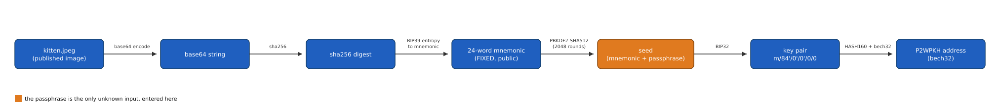
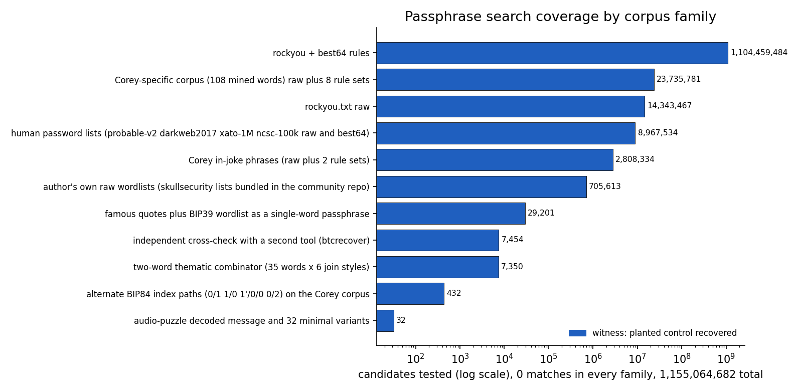

# Corey Phillips: Kitten Passphrase Puzzle (0.01 BTC, [OPEN])

Corey Phillips, a Bitcoin developer, published this puzzle in 2019: a photo of a kitten
whose bytes deterministically produce a fixed, public 24-word BIP39 mnemonic, and a
0.01 BTC address generated from that mnemonic plus a secret passphrase. The mnemonic and
the derivation are fully reproducible from the published image; the only unknown is the
passphrase, the "25th word." I have tested about 1.16 billion candidates across curated,
rule-mangled, and raw wordlist regions, with 0 matches, and confirmed the image carries
no hidden data beyond its role as the entropy source. The prize remains unclaimed; what
is missing is the passphrase itself.

## At a glance

| | |
|---|---|
| Author | Corey Phillips, developer at [Synonym](https://synonym.to/team), [Medium](https://corey-lyle-phillips.medium.com/), [GitHub @coreyphillips](https://github.com/coreyphillips) |
| Published | 2019-07-09, [Medium article](https://corey-lyle-phillips.medium.com/part-1-3-turn-your-photos-into-bitcoin-private-keys-addresses-57669771cf7a) |
| Prize | 1,001,900 sats (about $631 at BTC = $63,000, 2026-08-16) |
| Chain | bitcoin |
| Escrow | `bc1qcyrndzgy036f6ax370g8zyvlw86ulawgt0246r` ([mempool.space](https://mempool.space/address/bc1qcyrndzgy036f6ax370g8zyvlw86ulawgt0246r)) |
| Last on-chain check | 2026-10-24: re-checked; exact balance and state for every address in [verification/BALANCES.md](../../verification/BALANCES.md) |
| Status | OPEN |
| Puzzle type | bip39-seed, brainwallet |
| Target format | BIP39 24 words (fixed, public), unknown passphrase, BIP84 `m/84'/0'/0'/0/0` |
| Certified oracle | yes: `tools/oracle.py --selftest` (certified against the sister address for an empty passphrase) |
| What remains | the passphrase; about 1.16 billion candidates tested, 0 matches; the author states the puzzle "is not meant to be solved" |
| Series | none |

## The puzzle as published

Corey Phillips posted the puzzle image, `kitten.jpeg`, in a 2019-07-09 Medium article
demonstrating his "bitimage" method for turning any file into a Bitcoin key. In his own
words: "To prove the viability of this method, I have also sent 0.01 BTC to the following
address, `bc1qcyrndzgy036f6ax370g8zyvlw86ulawgt0246r`. This address was generated using
the kitten image along with a BIP39 passphrase. Remember, this is not meant to be solved.
It is meant to prove the viability of this method, but if you somehow manage to claim it,
congrats!" He adds that the same image, with an empty passphrase, sits behind a second
"sister" address holding a smaller amount: "The mnemonic for the kitten photo without a
passphrase contains roughly 0.00095133 BTC. Feel free to claim it if you manage to sweep
the keys in time."

A community-maintained hint repository mirrors this write-up ("This repository contains
all publicly known hints for BTC Puzzle by Corey Phillips challenge. Contributions are
welcome!") and adds the mechanism in plain terms (base64 the image, SHA-256 the result,
feed the digest to BIP39's `entropyToMnemonic`) plus 3 hints: working Python code to
derive keys from the image, a brute-force script over a `wordlists` folder, and a
suggestion to check the image for steganography with named public tools. The author
separately published a related "Bitcoin Audio Puzzle" (2020-01-05) in the same format
family (a 24-word seed on BIP84), which I decoded independently; it carries no passphrase
for this puzzle. No "Part 3" of his puzzle article series was ever published.

## What is understood

### Mechanism


*Figure 1. The image-to-address pipeline; the passphrase (orange box) is the only unknown input (source: data/pipeline-stages.json, script tools/fig_pipeline.py), 2026-08-16.*

The chain is: `kitten.jpeg` to base64 to SHA-256 to BIP39 `entropyToMnemonic` (24 words,
fixed) to seed (PBKDF2-HMAC-SHA512 over the mnemonic, salted with "mnemonic" plus the
passphrase, 2048 rounds) to BIP32 `m/84'/0'/0'/0/0` to a compressed public key to a
bech32 P2WPKH address. The 24-word mnemonic is entirely determined by the published
image and requires no guessing:
```
blossom educate state course sick fresh color divide number soap please pull glide weather join grit depart dynamic tenant leopard alter piano slight room
```
The only unknown in the whole chain is the BIP39 passphrase.

### Derivation and oracle

```
python3 tools/oracle.py --selftest              # reproduces the sister address
python3 tools/oracle.py "<candidate passphrase>" # MATCH or NO MATCH
python3 tools/oracle.py --stdin                  # one candidate per line
```

A candidate is used exactly as given (passphrases are case- and space-sensitive) and
pushed through the full derivation above; a match means the resulting bech32 address
equals the target byte for byte.

### Certified against

`tools/oracle.py --selftest` reproduces `sha256(base64(kitten.jpeg))` as
`1808d35318ac7cb98b69ff9779b699d6a631f15e0b353ac89b7c4020774832ed`, matching the
author's own published value exactly, and derives the empty-passphrase address as
`bc1q57euh23y3qs2f9d5mtwpax5lqecfvrdkqce82a`, the "sister" address the author names in
his own write-up. Reproduced 2026-08-16.

### Established facts

1. The image in `clues/kitten.jpeg` is byte-identical to the published puzzle image: its
   base64-then-SHA-256 digest matches the author's own quoted value exactly.
2. The 24-word mnemonic is fully determined by the image; the only unknown is the
   passphrase.
3. The image carries no hidden data beyond its role as the entropy source: exiftool shows
   clean metadata, binwalk finds only the JPEG structure, and `strings` shows only
   compression noise. Checked 2026-06-13.
4. The sister address (empty passphrase) has since been spent: it received 95,133 sats on
   2019-07-02 and was emptied the same week, on 2019-07-09; it later received an unrelated
   320,000 sats on 2024-09-22 and was emptied again the same day. It is not a target,
   only the calibration vector for the oracle. Checked 2026-08-16.
5. The author's related "Bitcoin Audio Puzzle" is fully decoded (FSK tones at 1080 and
   1260 Hz, demodulated with minimodem into a Bitcoin transaction carrying an OP_RETURN
   message describing a 24-word BIP84 seed), but the message is not a usable passphrase
   for this puzzle (tested, 0 match).
6. No "Part 3" of the author's article series exists; his Medium index lists exactly 4
   posts and nothing further.

## What has been tested


*Figure 2. Every corpus family tested, by candidate count (source: data/coverage.csv, script tools/fig_coverage.py), 2026-08-16.*

Full ledger in [analysis/tested.md](analysis/tested.md). Summary:

| Hypothesis | Space | Method | Result | Witness | Date |
|---|---|---|---|---|---|
| rockyou.txt with best64 mangling rules | 1,104,459,484 | GPU derivation | 0 match | yes: planted control recovered | 2026-06-13 |
| Corey-specific corpus (108 mined words), raw plus 8 rule sets | 23,735,781 | GPU derivation | 0 match | yes | 2026-06-13 |
| rockyou.txt raw | 14,343,467 | GPU derivation | 0 match | yes | 2026-06-13 |
| Human password lists (probable-v2, darkweb2017, xato-1M, ncsc-100k, raw and best64) | 8,967,534 | GPU derivation | 0 match | yes | 2026-06-13 |
| Corey in-joke phrases, raw plus 2 rule sets | 2,808,334 | GPU derivation | 0 match | yes | 2026-06-13 |
| Author's own bundled wordlists | 705,613 | CPU derivation | 0 match | yes | 2026-06-13 |
| 5 smaller families (quotes, combinator, audio message variants, alternate paths, btcrecover cross-check) | 44,469 | GPU and CPU derivation | 0 match | yes | 2026-06-13 |

Cumulative: 1,155,064,682 candidates tested, 0 matches, across 11 families. Witness
caveat that applies to every row: a control passphrase was recovered in the same run and
independently reproduced by a second tool, but its position within each run was not
separately logged, so this is a well-instrumented negative rather than a formally
exhaustive one.

## Open leads, ranked

1. **Ask the author directly** (needs a person, otherwise free). Every public source I
   can identify is exhausted: the related audio puzzle is fully decoded, there is no
   unpublished third article, and the image carries no hidden data. Corey Phillips is
   reachable through Medium, GitHub, and his employer Synonym's public accounts, and
   explicitly invites
   solvers in his own write-up. Confirmed by any reply that narrows the passphrase;
   killed by no reply, which leaves only the bounded fallbacks below.
2. **Safety-net derivation on BIP44 and BIP49** (minutes). The puzzle specifies BIP84, but
   replaying the existing 108-word corpus on BIP44 (`m/44'`) and BIP49 (`m/49'`) at the
   change level is nearly free and closes off an alternative-derivation explanation.
   Confirmed by a match on either path; killed by the expected 0 match.
3. **Three-word thematic combinator** (hours). Only two-word combinations from the
   puzzle's vocabulary have been tested; a three-word extension over the same curated
   list is a bounded, not-yet-run search. Confirmed by a match; killed by a full sweep
   with 0 matches.

Full notes: [analysis/leads.md](analysis/leads.md).

## Files in this folder

| Path | What it is |
|---|---|
| `clues/kitten.jpeg` | the published puzzle image, byte-identical to the author's original (sha256 of its base64 matches the author's own published value) |
| `clues/author-posts.md` | the author's own Medium article quotes and the community hint repository's mirrored hints, with dates and links |
| `data/coverage.csv` | candidate counts per corpus family tested, recomputed from my own run logs |
| `data/pipeline-stages.json` | the 7-stage label list for the derivation pipeline figure |
| `analysis/tested.md` | the complete negatives ledger |
| `analysis/leads.md` | full notes behind the 3 ranked leads |
| `images/01-pipeline-derivation.svg` | the image-to-address derivation pipeline diagram |
| `images/02-coverage-tested-space.png` | passphrase search coverage by corpus family |
| `tools/oracle.py` | candidate passphrase checker, certified against the sister address |
| `tools/fig_pipeline.py` | generates images/01-pipeline-derivation.svg from data/pipeline-stages.json |
| `tools/fig_coverage.py` | generates images/02-coverage-tested-space.png from data/coverage.csv |

## Sources

- Corey Phillips, "Part 1/3: Turn Your Photos Into Bitcoin Private Keys/Addresses", Medium, 2019-07-09: https://corey-lyle-phillips.medium.com/part-1-3-turn-your-photos-into-bitcoin-private-keys-addresses-57669771cf7a
- Corey Phillips, "A Bitcoin Audio Puzzle", Medium, 2020-01-05: https://corey-lyle-phillips.medium.com/a-bitcoin-audio-puzzle-61174b9849ce
- Community hint repository, GitHub (Schum-io/BTC-Puzzle-by-Corey-Phillips): https://github.com/Schum-io/BTC-Puzzle-by-Corey-Phillips
- Corey Phillips, "bitimage" tool, GitHub: https://github.com/coreyphillips/bitimage
- Corey Phillips, Medium index: https://corey-lyle-phillips.medium.com/
- Corey Phillips, GitHub: https://github.com/coreyphillips
- Escrow address, mempool.space: https://mempool.space/address/bc1qcyrndzgy036f6ax370g8zyvlw86ulawgt0246r
- Sister address (oracle calibration only), mempool.space: https://mempool.space/address/bc1q57euh23y3qs2f9d5mtwpax5lqecfvrdkqce82a
