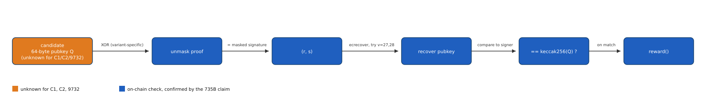
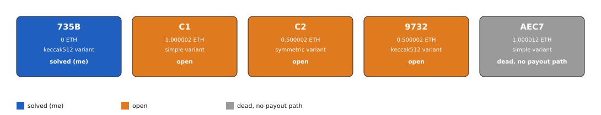

# TeikhosBounty: Johan Nygren's Proof-of-Public-Key Puzzles (2 ETH, [OPEN])

Johan Nygren deployed 5 small Ethereum contracts in 2018 to demonstrate a scheme he called
Teikhos (Greek for "fortification"): each pays its balance to whoever proves knowledge of a
public key never published, by submitting the key so the contract can check a masked
signature against it. I solved one of the five in 2026, recovering the needed public key
from a reverted 2022 transaction that had leaked it in its calldata, and claimed 0.5 ETH.
Three more remain open, worth 2 ETH combined; a fifth can never pay anyone, due to a bug in
its prototype code. For the 3 open contracts, no calldata leak or other trace of the
required keys has been found; the cryptography is sound, and the only real lever left is
asking the author where those keys are.

## At a glance

| | |
|---|---|
| Author | Johan Nygren, GitHub [resilience-me](https://github.com/resilience-me) (formerly `bipedaljoe`) |
| Published | 2018-02-25, contract deployment (earliest of the family); scheme described in a [GitHub issue](https://github.com/ethereum/EIPs/issues/935) and a [gist](https://gist.github.com/resilience-me/be11a0ed3575dddca10df8263b53cc1d), both 2018 |
| Prize | 2.000006 ETH across 3 open contracts (about $3,760 at ETH = $1,880, 2026-08-16) |
| Chain | ethereum |
| Escrow | 5 contracts, 1 per puzzle: 1 solved and drained, 3 open, 1 permanently unable to pay; full ledger with explorer links in [Solution](#solution) |
| Last on-chain check | 2026-10-24: re-checked; exact balance and state for every address in [verification/BALANCES.md](../../verification/BALANCES.md) |
| Status | OPEN |
| Puzzle type | smart-contract, timelock |
| Target format | the 64-byte uncompressed public key committed to at deployment (no 0x04 prefix); no private key is needed to claim, only the matching public key |
| Certified oracle | yes: `tools/oracle.py --selftest` (certified against the real public key I recovered and submitted to solve contract 735B, itself now public on chain since the winning transaction) |
| What remains | the public keys for the 3 open contracts, never published by the author and not recoverable from any on-chain or OSINT trace found so far |
| Series | this folder covers the full 5-contract family; there is no separate folder per contract |

## The puzzle as published

Nygren posted the scheme as a GitHub issue on the Ethereum EIPs repository on 2018-03-19,
informally called "EIP-935" though never assigned a formal EIP number:

> Uses one-time keys and a proof of the next public-private key pair included in each
> transaction, `proof_of_public_key = keccak256(nextPublicKey)`. I call the scheme Teikhos,
> from the Greek for "fortification".

He continues, in the same issue body, that the name reflects how the scheme hides the
asymmetric cryptography behind a one-way hash function, the way a fortification hides what
is behind it. The same idea appears as a reference implementation in a gist,
`ProofOfSymmetricKey.sol` (created 2018-02-27). The puzzles themselves are 5 deployed
contracts sharing one creator address, `0x4c5D24A7Ca972aeA90Cc040DA6770A13Fc7D4d9A`, each
funded with ETH and each storing a masked signature that only the correct public key can
unmask into something `ecrecover` accepts. The `authenticate()` function of the simplest
variant, verified Solidity as deployed at `0x17e5e0910b9185b0ede564dcbf074ca910ad56a4`:

```solidity
function authenticate(bytes _publicKey) {
    address signer = address(keccak256(_publicKey));
    bytes32 publicKey1;
    bytes32 publicKey2;
    assembly {
    publicKey1 := mload(add(_publicKey,0x20))
    publicKey2 := mload(add(_publicKey,0x40))
    }
    bytes32 r = proof_of_public_key1 ^ publicKey1;
    bytes32 s = proof_of_public_key2 ^ publicKey2;
    bytes32 msgHash = keccak256("\x19Ethereum Signed Message:\n64", _publicKey);
    if(ecrecover(msgHash, 27, r, s) == signer) suicide(msg.sender);
    if(ecrecover(msgHash, 28, r, s) == signer) suicide(msg.sender);
}
```

No separate bounty announcement has been found on any public channel; the contracts, funded
and left open for years, are the only public trace of the puzzles. Full quotes in
[clues/author-posts.md](clues/author-posts.md).

## What is understood

### Mechanism

`authenticate()` checks whether a submitted 64-byte public key `Q` unmasks the contract's
stored proof into a valid ECDSA signature `(r, s)` of a fixed message under the address
`keccak256(Q)`. Since masking and `ecrecover` are both deterministic functions of `Q` alone,
the only way to pass the check is to submit the exact `Q` the creator committed to; there is
no algebraic shortcut. The family uses 3 masking variants (simple, symmetric, and a
keccak512-based commit-reveal design); full detail, the family map, and why AEC7 can never
pay out are in [analysis/mechanism.md](analysis/mechanism.md).


*Figure 1. The authenticate() check, confirmed against the real solution used to claim 735B (source: data/pipeline-stages.json, script tools/fig_pipeline.py), 2026-08-16.*


*Figure 2. The full contract family, colored by state (source: data/contracts.csv, script tools/fig_family.py), 2026-08-16.*

### Derivation and oracle

```
python3 tools/oracle.py --selftest                  # must print SELFTEST OK
python3 tools/oracle.py <64-byte-pubkey-hex>         # checks against all 5 contracts
python3 tools/oracle.py --contract C1 <pubkey-hex>   # checks one contract only
python3 tools/oracle.py --stdin                      # one pubkey per line
```

A candidate public key is unmasked against each contract's stored proof using that
contract's variant, then checked with ECDSA public-key recovery against both recovery ids.
`MATCH <tag> <address> recid=<0|1> v=<27|28>` on a hit, `NO MATCH` otherwise, exit code 0 or
1. This tool only checks offline; it never broadcasts anything. C1 and C2 pay whoever's
transaction succeeds, so a correct key found this way is front-runnable in a public mempool
and should only ever be submitted through a private relay.

### Certified against

`tools/oracle.py --selftest` reproduces the real solve: the 64-byte public key I recovered
and submitted for contract 735B,
`ca6a98ceec61e213d9a0a8fdc0a6d5d9ed7566f5f4cfd24871fb9316feb6e1eb2367489f54a0cd4111f4c5356eb744d299a7521296786223c70947c8c36940c6`,
reproduces the exact match (recovery id 0, `v=27`) against 735B's real proof values, and a
deliberately altered version of the same key fails. This certifies the full on-chain check,
including the keccak512 variant. Reproduced 2026-08-16.

### Established facts

1. All 5 contracts share one creator, `0x4c5D24A7Ca972aeA90Cc040DA6770A13Fc7D4d9A`. C1, C2,
   and 9732 hold 1.000002, 0.500002, and 0.500002 ETH respectively, all funded and unspent,
   confirmed via `eth_getBalance` on 2026-08-16.
2. AEC7's `authenticate()` function, disassembled in full (911-byte runtime), has no
   `SELFDESTRUCT` or value-transferring opcode reachable from any input; its 2 `CALL`
   instructions both target the `ecrecover` precompile with zero value. Its 1.000012 ETH
   cannot be paid to anyone, including its own creator, regardless of the key submitted.
3. C1's, C2's, and AEC7's proof values, read directly from contract storage today, match the
   values recorded during my original research; none have changed since deployment.
4. 9732's proof values, read directly from contract storage today, also match; its variant
   (keccak512) is recorded by analogy with its twin 735B rather than independently confirmed
   from a verified source in this session.
5. 735B was solved because a public key had already leaked: a transaction on 2022-04-03
   (`0x7e2596f9f202aad8a90e84cf93e32e7b3fb0ba244491d84542cedaf089a553c4`, from an unrelated
   address `0x9c739dfa1674eae112dcdfb163653cf20d9d2070`) called `authenticate()` with the
   correct public key in its calldata but reverted. I found this transaction, extracted the
   public key from its calldata, and used it to solve the contract in 2026. No such leaked
   calldata exists for C1, C2, or 9732.
6. C1, C2, and 9732 target addresses with transaction count (nonce) 0 on every EVM chain
   checked: they have never signed anything on any chain I could check, so there is no
   signed message to recover a public key from by the usual route.

## What has been tested

Full ledger in [analysis/tested.md](analysis/tested.md). Summary:

| Hypothesis | Space | Method | Result | Witness | Date |
|---|---|---|---|---|---|
| A usable public key was already submitted on chain to C1, C2, or 9732 | full calldata history of all 5 contracts | direct calldata inspection | 2 prior attempts found (against C1 and 9732), both checked offline and confirmed wrong | yes: oracle correctly matches the real 735B solution and rejects an altered key | 2026-06-14 |
| The author's GitHub gists leak a key in their edit history | 10 gists, 103 revisions, 127 gists/forks/51 repos across his full GitHub footprint | diff every revision for embedded key-length hex values | 0 found; about 125 of 127 gists have since been deleted | uncertified | 2026-06-14 |
| A Rinkeby or Goerli testnet deployment leaked a signed transaction | both testnets' available archives | archive search | 0 found; no archive covers this era for either network | uncertified | 2026-06-14 |
| The creator signed a transaction on another EVM chain | 11 live chains | nonce check on the creator and target addresses | 0 found; nonce 0 everywhere | not applicable, direct read | 2026-06-14 |
| The private key follows a weak or brainwallet-style pattern | rockyou wordlist, 14 million entries, 5 derivation schemes | derive and check against known addresses | 0 match | uncertified | 2026-06-14 |

Cumulative: every leak channel checked so far is a dead end by the scheme's design (the
public key is unrecoverable from anything on chain until revealed), not from an incomplete
search of the 256-bit key space itself, which has no meaningful brute-force witness.

## Open leads, ranked

1. **Ask Johan Nygren directly** (the time to write and send one message). He is reachable
   (GitHub `resilience-me`, Reddit `johanngr`, Steemit `@johan-nygren`, X/Medium
   `@resilience_me`, active as recently as 2024 to 2026 on an unrelated project) and is the
   only person who has ever held these keys. This is the only lever with a real chance of
   working; I have not sent it yet.
2. **Passive triggers** (no action until they occur): a testnet snapshot covering this era
   resurfaces, the author reveals a key anywhere public, or a competitor submits a correct
   key to C1 or C2 in a public transaction, which would make that key visible to everyone at
   the moment it is broadcast.

Full notes: [analysis/leads.md](analysis/leads.md).

## Solution

I solved one of the five contracts, 735B, in 2026 and claimed 0.5 ETH. The other four are
covered here as the rest of the family: 3 remain open, and 1 (AEC7) can never pay out to
anyone.

### The 5-contract ledger

| Tag | Address | Balance now | Variant | State |
|---|---|---|---|---|
| 735B | [`0x735ba26f91e1275fa4b504649b19ef74739fe7e7`](https://etherscan.io/address/0x735ba26f91e1275fa4b504649b19ef74739fe7e7) | 0 ETH | keccak512 | solved by me, 2026-06-21 |
| C1 | [`0x17e5e0910b9185b0ede564dcbf074ca910ad56a4`](https://etherscan.io/address/0x17e5e0910b9185b0ede564dcbf074ca910ad56a4) | 1.000002 ETH | simple | open |
| C2 | [`0xd7c6d542f3dcdceda845112b8fd567b8f8655805`](https://etherscan.io/address/0xd7c6d542f3dcdceda845112b8fd567b8f8655805) | 0.500002 ETH | symmetric | open |
| 9732 | [`0x973c2178b09225d1de3ab037d40b3f24af696255`](https://etherscan.io/address/0x973c2178b09225d1de3ab037d40b3f24af696255) | 0.500002 ETH | keccak512 | open |
| AEC7 | [`0xaec7e8c221c3fd24e75c996e32289235fd899ebf`](https://etherscan.io/address/0xaec7e8c221c3fd24e75c996e32289235fd899ebf) | 1.000012 ETH | simple | dead: no payout path for anyone |

### 735B (`0x735ba26f91e1275fa4b504649b19ef74739fe7e7`)

**Answer**: the 64-byte uncompressed public key
```
ca6a98ceec61e213d9a0a8fdc0a6d5d9ed7566f5f4cfd24871fb9316feb6e1eb2367489f54a0cd4111f4c5356eb744d299a7521296786223c70947c8c36940c6
```

**Derivation**: this key was never guessed. On 2022-04-03, an unrelated address,
`0x9c739dfa1674eae112dcdfb163653cf20d9d2070`, attempted to solve 735B with a transaction
calling `authenticate(bytes)` with exactly this public key as its argument
(`0x7e2596f9f202aad8a90e84cf93e32e7b3fb0ba244491d84542cedaf089a553c4`,
[etherscan](https://etherscan.io/tx/0x7e2596f9f202aad8a90e84cf93e32e7b3fb0ba244491d84542cedaf089a553c4),
block 14,513,678). That transaction reverted, most likely because it violated the
commit-reveal timing this contract's variant requires, but the public key itself is exactly
correct and sat in that transaction's calldata, permanently public, from that date onward. I
found this transaction, extracted the key, and reused it correctly: `commit()` at block
25,314,735, `authenticate()` at block 25,314,741 (both 2026-06-14, both via Flashbots to
avoid front-running the commit), then `reward()` after the contract's 7-day delay.

**Key material**: no private key is involved in solving this puzzle; the winning input is
the public key above. I do not hold the corresponding private key.

**Payout**: txid
[`0x4d2bfceb311bda8d265debab1c8ad23cb860922b876eca523327d0405ab97bff`](https://etherscan.io/tx/0x4d2bfceb311bda8d265debab1c8ad23cb860922b876eca523327d0405ab97bff),
block 25,365,185, confirmed 2026-06-21 09:51:23 UTC, 0.5 ETH to
`0x83e4b2a5A464bDfCD83057Ac08447f533A595156`.

**What it teaches about the series**: the scheme's cryptography holds; the only route in for
this family is a leak outside the contract itself, here a failed prior attempt that
broadcast the correct key without realizing the transaction would revert. C1, C2, and 9732
have no equivalent leaked transaction (established fact 5 above); until one appears, or the
author discloses a key directly, they stay closed by design rather than by any weakness.

**How I got there**: I searched the full calldata history of every contract in the family
for prior `authenticate()` attempts, checked each one offline against the correct proof
values, and found that the specific 2022 attempt against 735B carried the right key despite
having failed on chain. Submitting it correctly, respecting the commit-reveal delay and
routing through Flashbots to avoid a front-run of the commit step, was the rest of the work.

## Files in this folder

| Path | What it is |
|---|---|
| `clues/author-posts.md` | the author's GitHub issue and gist text, and the verified authenticate() source, with links |
| `data/pipeline-stages.json` | stage labels for the derivation pipeline figure |
| `data/contracts.csv` | the 5-contract ledger (balance, variant, state), from on-chain reads |
| `analysis/mechanism.md` | full mechanism detail: the 3 masking variants, why AEC7 is dead, why C1/C2 are front-run risks |
| `analysis/tested.md` | the complete negatives ledger for C1, C2, and 9732 |
| `analysis/leads.md` | full notes behind the 2 ranked leads |
| `images/01-pipeline-derivation.svg` | the authenticate() verification pipeline |
| `images/02-family-map.svg` | the 5-contract family, colored by state |
| `tools/oracle.py` | candidate public-key checker for all 5 contracts, certified against the real 735B solution |
| `tools/fig_pipeline.py` | generates images/01-pipeline-derivation.svg from data/pipeline-stages.json |
| `tools/fig_family.py` | generates images/02-family-map.svg from data/contracts.csv |

## Sources

- Johan Nygren, "Signature idea for use with account abstraction", GitHub issue, ethereum/EIPs #935, 2018-03-19: https://github.com/ethereum/EIPs/issues/935
- Johan Nygren, ProofOfSymmetricKey.sol, gist, 2018-02-27: https://gist.github.com/resilience-me/be11a0ed3575dddca10df8263b53cc1d
- C1 verified source, Etherscan: https://etherscan.io/address/0x17e5e0910b9185b0ede564dcbf074ca910ad56a4#code
- The 2022 reverted attempt that leaked 735B's public key, Etherscan: https://etherscan.io/tx/0x7e2596f9f202aad8a90e84cf93e32e7b3fb0ba244491d84542cedaf089a553c4
- 735B payout transaction, Etherscan: https://etherscan.io/tx/0x4d2bfceb311bda8d265debab1c8ad23cb860922b876eca523327d0405ab97bff
