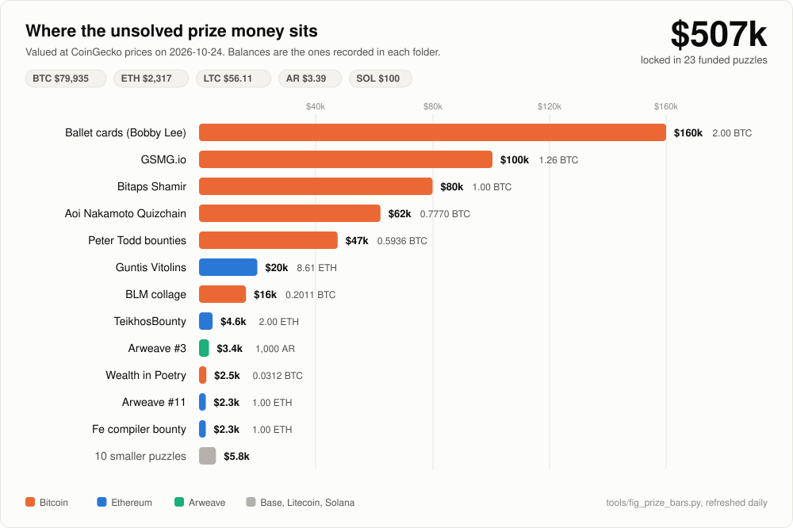

# unsolved-crypto-puzzles

A verified archive of public crypto treasure hunts whose prizes are still on-chain. An author
locks bitcoin, ether, arweave or a token behind a riddle, publishes the escrow address, and
invites the public to solve it and keep what is there. This repository keeps the puzzles that
are still funded, with the address, the author's clues, what has been tried, and where the
work got stuck.

Research and first-person notes are by **floflo777**, who worked about 40 of these and solved
a few. This is a maintained mirror of
[floflo777/open-crypto-puzzles](https://github.com/floflo777/open-crypto-puzzles): every
escrow was re-checked on **2026-10-24**, puzzles whose prize had been swept were removed, and
the already-solved tier is not copied. Pick one and keep going.

## Still unsolved, sitting on-chain

*The biggest unsolved prizes on-chain right now, at live CoinGecko prices. Balances are the
ones recorded in each folder and re-checked with `tools/check_escrows.py`; the tables below are
regenerated from the manifests by `tools/build_index.py`.*

<!-- totals:start -->
| Asset | Locked in unsolved puzzles | Approx. value |
|---|---|---|
| Bitcoin | 5.91 BTC | $477,000 |
| Ethereum | 12.66 ETH | $30,000 |
| Arweave | 1,500 AR | $5,200 |
| Litecoin | 3.03 LTC | $200 |
| Stablecoins | 0 USDT + 0 USDC | $0 |
| NFT | 1 prize | no cash value recorded |
| **Total** | **across 23 funded puzzles** | **$512,000** |

Checked 2026-10-24 at BTC $80,765, ETH $2,354.82, AR $3.47, LTC $56.96, USDT $1.0. Prices and balances move; verify each escrow yourself.
<!-- totals:end -->

### What changed in this snapshot

- **23 puzzles remain funded.** Two puzzles that were open in the previous snapshot are gone:
  [Smith, Lyle & Moore Hunt #2](https://mempool.space/address/bc1q0akdjvrc2csau2n3gyxa3xcq0fss852x997m9y)
  had its 3,177,700 sats swept on 2026-10-22, and FTPK Season 2's 310.372091 USDT left the
  escrow on 2026-09-10.
- **The solved tier is not copied.** The 13 puzzles in the previous archive's solved tier,
  including LogicBeach, Arweave #12, CaesarCoder and Zden LVL5, are omitted here. Their
  write-ups and payout proofs remain in the original repository.
- **Every remaining address was re-checked.** The full per-address table, including decoys,
  payout addresses and contracts, is in [verification/BALANCES.md](verification/BALANCES.md);
  the removal record is in [verification/REMOVED.md](verification/REMOVED.md).

## How to read this repository

1. Pick a tier below. Prizes are grouped by USD value at the snapshot date.
2. Open the puzzle folder. `README.md` is the whole story: clues, mechanism, tested, leads.
3. Before any effort, re-check the escrow yourself: click the explorer link in "At a glance"
   or read [docs/verify-funding.md](docs/verify-funding.md). The chain is the truth, not this file.
4. `analysis/tested.md` is what not to redo. `analysis/leads.md` is where to start.
5. If you solve one: sweep first, then tell people. See [CONTRIBUTING.md](CONTRIBUTING.md).

## How to use it with an AI agent

Point your agent (Claude Code, Codex, Cursor, or any other) at [AGENTS.md](AGENTS.md). It
contains the rules and a starter prompt. The machine-readable index is
[puzzles.json](puzzles.json); each folder has a `puzzle.json` and, when the derivation is
known, `tools/oracle.py --selftest`.

## Engines

The GPU and CPU bruteforce engines are in [engines/](engines/): a checksum-aware BIP39 seed
and passphrase kernel (about 790k derivations/s), a brainwallet
`SHA256 -> secp256k1 -> hash160` kernel (about 9.3M keys/s), an Electrum v1 old-seed engine,
and two Arweave key-stretch engines. They ship as CUDA source plus Python host drivers with
self-tests; build them with `engines/build.sh` (nvcc), then point one at a puzzle's target.
See [engines/README.md](engines/README.md).

## Start here: ten to look at first

If you do not know where to begin, these ten are the clearest to pick up. The full list,
grouped by prize, is in the tables below.

| Puzzle | Prize | Why it is a good place to start |
|---|---|---|
| [Keir Finlow-Bates: book treasure hunt](2-mid-prizes/keir-finlow-bates-blockchain-book-600ksats/) | 600,000 sats open, 4 lots solved | The write-ups show exactly how the author hides a key, which is the strongest lead for the 3 still open. |
| [Corey Phillips: kitten passphrase](2-mid-prizes/corey-phillips-kitten-passphrase-1msats/) | 0.010019 BTC | The seed is fixed and public; only one BIP39 passphrase is missing. A clean, bounded target to point a tool at. |
| [GSMG.io puzzle](1-big-prizes/gsmg-io-5btc-puzzle/) | 1.25649674 BTC | A famous multi-stage hunt; every stage but the last is solved. The final gate is two sealed AES blobs. |
| [Guntis Vitolins MetaMask seed](1-big-prizes/guntis-vitolins-metamask-8-6eth/) | 8.612541554266 ETH | The largest cash prize here. A 12-word seed scattered across the author's own clues. |
| [Ballet / Bobby Lee cards](1-big-prizes/ballet-bobby-lee-2btc-cards/) | 2.00007358 BTC | Two physical Ballet cards, 1 BTC each. Each needs one hidden half that was never photographed. |
| [Aoi Nakamoto Quizchain](1-big-prizes/aoi-nakamoto-quizchain-0-854btc/) | 0.777 BTC | The key comes from a Wattpad chapter run through MD5. The rule is certified on a solved sibling block. |
| [BLM collage seed](1-big-prizes/blm-brave-new-world-0-2btc/) | 0.20107284 BTC | A whole seed hidden inside one large collage image: runes, micro-text, a clock. |
| [Arweave Puzzle #11](2-mid-prizes/arweave-puzzle-11-1eth/) | 1 ETH | A single grayscale sketch that encodes a raw 64-hex private key. |
| [Path to Greatness: Treasure Hunt](2-mid-prizes/path-to-greatness-treasure-hunt-3ltc/) | 3.02608794 LTC | The author drew his own encryption on one of the clue images: four independent two-answer locks, each with an exact test, so a guess is settled in microseconds. |
| [Pindar Van Arman: cryptoArtGAN Act 1](2-mid-prizes/pindar-van-arman-cryptoartgan-nft/) | 1 NFT | The wallet holds a single ERC-1155 prize and has never signed a transaction; the clue is two sentences about 11 "glitches". |

<!-- generated:start -->
## Big prizes (>= $10,000)
| Puzzle | Prize | USD | Chain | Type | What remains | Escrow checked | Status |
|---|---|---|---|---|---|---|---|
| [Ballet / Bobby Lee: Take Bobby's Bitcoin](1-big-prizes/ballet-bobby-lee-2btc-cards/) | 2.00007358 BTC | 161,536 | bitcoin | bip38, physical-object | external-info | 2026-10-24 | open |
| [GSMG.io Puzzle](1-big-prizes/gsmg-io-5btc-puzzle/) | 1.25649674 BTC | 101,481 | bitcoin | text-cipher, pixel-code, web-tree, raw-private-key | insight | 2026-10-24 | open |
| [Bitaps Shamir Secret Sharing Challenge](1-big-prizes/bitaps-shamir-challenge-1btc/) | 1.00016775 BTC | 80,779 | bitcoin | shamir, bip39-seed | external-info | 2026-10-24 | open |
| [Aoi Nakamoto Quizchain](1-big-prizes/aoi-nakamoto-quizchain-0-854btc/) | 0.777 BTC | 62,754 | bitcoin | bip39-seed, word-selection | external-info | 2026-10-24 | open |
| [Peter Todd Hash Collision Bounties](1-big-prizes/peter-todd-hash-collision-bounties-0-59btc/) | 0.59364885 BTC | 47,946 | bitcoin | hash-collision | research-breakthrough | 2026-10-24 | watch |
| [Guntis Vitolins: 10 ETH Challenge](1-big-prizes/guntis-vitolins-metamask-8-6eth/) | 8.612541554266 ETH | 20,281 | ethereum | bip39-seed, word-selection, video-series | bounded-compute | 2026-10-24 | open |
| [BLM Collage: Welcome to the Brave New World](1-big-prizes/blm-brave-new-world-0-2btc/) | 20,107,284 sats | 16,240 | bitcoin | image-stego, word-selection, bip39-seed, text-cipher | insight | 2026-10-24 | open |

## Mid prizes ($100 to $10,000)
| Puzzle | Prize | USD | Chain | Type | What remains | Escrow checked | Status |
|---|---|---|---|---|---|---|---|
| [TeikhosBounty: Johan Nygren's Proof-of-Public-Key Puzzles](2-mid-prizes/teikhos-bipedaljoe-solver-bounties-2eth/) | 2.000006078 ETH | 4,710 | ethereum | smart-contract, timelock | external-info | 2026-10-24 | open |
| [Arweave Puzzle #3](2-mid-prizes/arweave-puzzle-3-1000ar/) | 1,000.165838006237 AR | 3,471 | arweave | word-selection, text-cipher | insight | 2026-10-24 | open |
| [Trithemius: Wealth in Poetry](2-mid-prizes/wealth-in-poetry-0-03btc/) | 3,124,630 sats | 2,524 | bitcoin | bip39-seed, text-cipher, brainwallet | insight | 2026-10-24 | open |
| [Arweave Puzzle #11](2-mid-prizes/arweave-puzzle-11-1eth/) | 1 ETH | 2,355 | ethereum | image-stego, pixel-code, raw-private-key | insight | 2026-10-24 | open |
| [Bountiful: the Fe compiler bug bounty](2-mid-prizes/fe-lang-bountiful-compiler-bounty-1eth/) | 1 ETH | 2,355 | ethereum | smart-contract, timelock | insight | 2026-10-24 | open |
| [Arweave Puzzle #10](2-mid-prizes/arweave-puzzle-10-500ar/) | 500.02225493 AR | 1,735 | arweave | word-selection, text-cipher | insight | 2026-10-24 | open |
| [Corey Phillips: Kitten Passphrase Puzzle](2-mid-prizes/corey-phillips-kitten-passphrase-1msats/) | 1,001,900 sats | 809 | bitcoin | bip39-seed, brainwallet | external-info | 2026-10-24 | open |
| [RushWallet Contest #30](2-mid-prizes/rushwallet-contest-30-1msats/) | 1,000,000 sats | 808 | bitcoin | brainwallet, audio | external-info | 2026-10-24 | open |
| [School of Bitcoin: 1 Million Sats In This Image](2-mid-prizes/school-of-bitcoin-1msats/) | 1,000,000 sats | 808 | bitcoin | bip39-seed, image-stego, password-pages | external-info | 2026-10-24 | open |
| [AH White: Walking Banks](2-mid-prizes/ah-white-walking-banks-800ksats/) | 800,000 sats | 646 | bitcoin | bip39-seed, book, text-cipher | external-info | 2026-10-24 | open |
| [Keir Finlow-Bates: Move Over Brokers Treasure Hunt](2-mid-prizes/keir-finlow-bates-blockchain-book-600ksats/) | 600,000 sats | 485 | bitcoin | book, brainwallet, text-cipher | human-action | 2026-10-24 | open |
| [Zden Level HALV](2-mid-prizes/zden-haluska-halv-312ksats/) | 312,500 sats | 252 | bitcoin | geometry, raw-private-key | external-info | 2026-10-24 | open |
| [Path to Greatness: Treasure Hunt](2-mid-prizes/path-to-greatness-treasure-hunt-3ltc/) | 3.02608794 LTC | 172 | litecoin | raw-private-key, image-stego, audio, text-cipher | insight | 2026-10-24 | open |
| [Pindar Van Arman: cryptoArtGAN Act 1 Puzzle](2-mid-prizes/pindar-van-arman-cryptoartgan-nft/) | 1 NFT |  | ethereum | bip39-seed, word-selection | insight | 2026-10-24 | open |

## Small prizes (< $100)
| Puzzle | Prize | USD | Chain | Type | What remains | Escrow checked | Status |
|---|---|---|---|---|---|---|---|
| [Crypto Puzzles 2018: Puzzle #2](3-small-prizes/crypto-puzzles-2018-puzzle-2-0-05eth/) | 0.05 ETH | 118 | ethereum | raw-private-key, image-stego, video-series | external-info | 2026-10-24 | open |
| [Exitonly Bitcoin Challenge 14](3-small-prizes/exitonly-challenge-14-30ksats/) | 30,000 sats | 24 | bitcoin | bip39-seed, word-selection | uneconomic | 2026-10-24 | open |
<!-- generated:end -->

## Series

- **Arweave:** #3, #10 and #11 are open; #12 was solved and is not copied here; #8, solved by
  others, remains the oracle calibration.
- **Zden (crypto.haluska.sk):** HALV is open; LVL5 was solved and is not copied here.
- **FTPK:** no funded season remains. Season 2 was swept on 2026-09-10 and Season 4 was
  solved; Seasons 1 and 3 are finished but still playable, and are useful for learning the
  author's grammar.
- **Finlow-Bates "Blockchain book":** 12 lots, 3 open, 4 solved by floflo777, 5 by others.
- **Aoi Nakamoto Quizchain:** Real Big Block is open; Block 76 was swept on 2026-08-17;
  Block 77 Stage One was reproduced.

## On-chain check policy

Every address in this repository was checked on 2026-10-24. The date is in each table and each
`puzzle.json`; the full per-address snapshot is in [verification/BALANCES.md](verification/BALANCES.md).
Prices and balances move. Run `python3 tools/check_escrows.py` for a fresh table, or open the
explorer links. If you find a drift, open an issue with the txid.

## Method, in short

Oracle first: reproduce a known-good vector before searching. A negative counts only with a
witness. A solution is an exact match, character for character. Insight over compute: if a
run needs hours, the constraint has not been found yet. Details: [docs/methodology.md](docs/methodology.md).

## Disclaimer

These are public puzzles. Each reward was funded and published by the puzzle's own author,
who invited the public to solve it and take it. Nothing here targets a third party's wallet,
lost keys, or private data. Solving one of these puzzles is what the author asked for. This
mirror does not guarantee that any escrow is still funded when you read it: check the chain.
It is not affiliated with any puzzle author. Do not send funds to any address in this
repository.

## License and third-party material

The research text, data tables and illustrations are by floflo777 and are reproduced under
[CC BY 4.0](LICENSE); code under `tools/` and `*/tools/` is under [MIT](LICENSE-CODE). The
original archive is [floflo777/open-crypto-puzzles](https://github.com/floflo777/open-crypto-puzzles).
Puzzle images and short quotes remain the property of their authors; they are reproduced as
published because they are the challenge itself. Books, audiobooks and articles are not
reproduced; each folder links to where to find them.

## Contact

Research by floflo777, X: [@0xFlorent_](https://x.com/0xFlorent_). Issues on this repository
for corrections, solves, and new leads.
